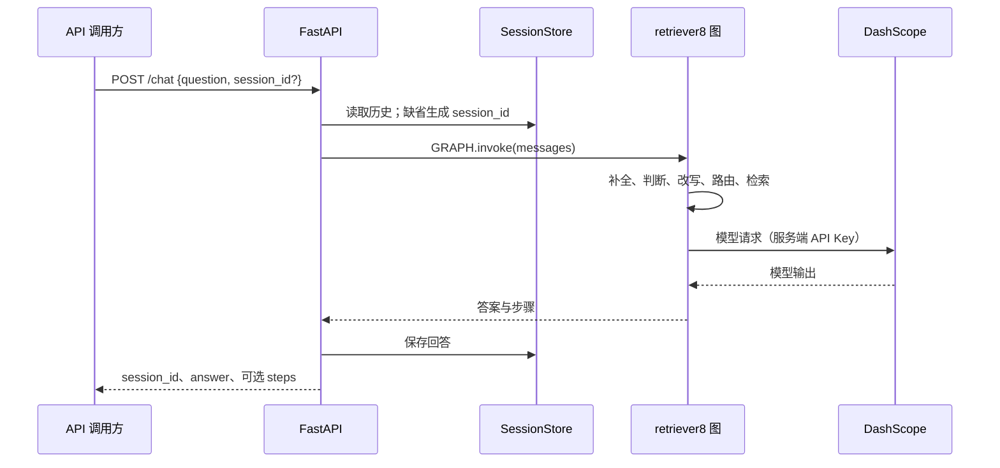

# 认证、请求流程与凭据处理

本文依据当前仓库实现整理。项目存在两个 HTTP 入口：FastAPI 问答 API 和 LangGraph Server。Agent Chat UI 使用后者的协议，不能直接把 API URL 指向 FastAPI 的 `/chat`。

## 组件与责任

| 组件 | 代码或文档 | 当前行为 |
| --- | --- | --- |
| FastAPI 入口 | [`main.py`](../main.py) | 接收问答、查询和清空历史；没有认证依赖、用户表或 token 校验 |
| 会话存储 | `main.py` 的 `SessionStore` | 按调用者传入的 `session_id` 保存内存历史；缺省生成 UUID；没有用户归属检查 |
| RAG 图与模型客户端 | [`retriever8.py`](../src/agent/retriever8.py) | 从环境读取模型 Key，创建 `ChatOpenAI`，执行检索与生成 |
| 产品检索 | [`query_xiaomi_products.py`](../xiaomi_entity/query_xiaomi_products.py) | 从 `ELASTICSEARCH_URL` 建立客户端；未单独配置 `basic_auth` 或 API Key 参数 |
| LangGraph 配置 | [`langgraph.json`](../langgraph.json)、[`start-langgraph.ps1`](../start-langgraph.ps1) | 加载 `.env` 和图入口；配置未声明自定义 auth 处理器 |
| 浏览器 Key 读取 | [`api-key.tsx`](../agent-chat-ui/src/lib/api-key.tsx) | 读取 `localStorage["lg:chat:apiKey"]`；服务端渲染时返回 null |
| 流式调用与状态检查 | [`Stream.tsx`](../agent-chat-ui/src/providers/Stream.tsx) | 保存 Key，传给 `useStream`；`GET /info` 显式携带 `X-Api-Key` |
| 会话列表客户端 | [`Thread.tsx`](../agent-chat-ui/src/providers/Thread.tsx)、[`client.ts`](../agent-chat-ui/src/providers/client.ts) | 将同一个 Key 传给 LangGraph SDK，搜索 threads |
| Next.js API 代理 | [`route.ts`](../agent-chat-ui/src/app/api/%5B..._path%5D/route.ts) | 把服务端 URL 和 Key 交给 `initApiPassthrough`；未增加用户登录或权限判断 |
| 部署说明 | [前端 README](../agent-chat-ui/README.md#going-to-production) | 介绍 API 代理和自定义认证；自定义认证段落属于指引，当前未实现 |

## 请求流程一：FastAPI



`main.py` 先加载根目录 `.env`（`override=True`），再导入 `retriever8`。`/ask` 调用同一流水线但不保存历史。历史接口根据 `session_id` 直接读取或删除数据，没有校验调用者是否拥有该会话。

本路径没有登录、Bearer token、JWT、refresh token 或认证 cookie。UUID 不能代替访问控制。`allow_origins=["*"]` 和 `allow_credentials=True` 是 CORS 设置，没有提供身份或权限校验。

## 请求流程二：Agent Chat UI → LangGraph

直连模式：

1. `StreamProvider` 从 URL 参数或 `NEXT_PUBLIC_API_URL`、`NEXT_PUBLIC_ASSISTANT_ID` 取得服务地址和图标识；Key 从 `getApiKey()` 读取。
2. 配置表单提交时，Key 写入 `lg:chat:apiKey`，并保存在 React 状态中。password 输入框只隐藏屏幕显示，不加密存储。
3. `checkGraphStatus()` 请求 `${apiUrl}/info`，有 Key 时添加 `X-Api-Key`。`useTypedStream` 和 SDK `Client` 通过 `apiKey` 参数获得同一凭据，执行流式运行和会话列表请求。
4. 上游是否接受或要求 Key，由连接的 LangGraph 服务及部署配置决定。仓库没有实现自己的上游 token 校验器。

代理模式（见前端 README）：

```text
浏览器 → Next.js /api/* → LangGraph Server → RAG 图 → DashScope
             ↑ 服务端 LANGSMITH_API_KEY          ↑ DASHSCOPE_API_KEY
```

设置 `NEXT_PUBLIC_API_URL` 为前端站点的 `/api` 地址，设置 Next.js 服务端的 `LANGGRAPH_API_URL` 和 `LANGSMITH_API_KEY`。catch-all 路由把配置交给代理库，由代理处理上游认证。`LANGSMITH_API_KEY` 不应使用 `NEXT_PUBLIC_` 前缀。

未配置时，路由使用 `"remove-me"` 占位符，因此需要显式配置后才可使用代理。隐藏上游 Key 只解决凭据位置问题；当前代理入口自身没有登录校验。前端 README 中展示的自定义 token headers 示例也没有接入当前代码。

## 凭据与 token 生命周期

| 名称 | 来源与保存位置 | 使用边界 |
| --- | --- | --- |
| `DASHSCOPE_API_KEY` | Python 进程环境或根目录 `.env` | 要求变量存在；传给 `ChatOpenAI(api_key=...)`，也复制为进程内 `OPENAI_API_KEY`；不返回浏览器 |
| 浏览器 LangSmith Key | 用户输入；明文 localStorage 与 React 内存 | 直连 LangGraph；跨刷新保留，可被同源 JavaScript 读取 |
| Next.js `LANGSMITH_API_KEY` | Next.js 服务端环境 | API 代理访问 LangGraph 的共享上游凭据；与 DashScope Key 用途不同 |
| Python `LANGSMITH_API_KEY` | Python 环境（可选） | 供 LangSmith 集成使用；不会自动保护 FastAPI 接口 |
| `session_id` / `threadId` | FastAPI 生成或调用方提供 / LangGraph SDK | 对话标识；`threadId` 出现在前端 URL 参数中；不是认证 token |

没有发放、刷新、吊销或过期检查 token 的逻辑，也没有应用级登出流程。`getApiKey()` 只读取 localStorage；尽管 `Stream.tsx` 的注释提到环境变量回退，实际没有实现客户端 Key 的环境变量回退。

`.env` 与 `.env.*` 被忽略，仅保留 `.env.example`。`load_dotenv(override=True)` 意味着 `.env` 会覆盖已经存在的同名环境变量；部署时应确认实际生效的来源。不要把带密码的 Elasticsearch URL 写进文档或日志。

## 上传前处理与现存边界

本次上传移除了 13 处硬编码模型 Key 回退，改为要求 `DASHSCOPE_API_KEY`。未配置时会在读取该变量时失败，避免悄悄使用共享凭据。

旧的 `master` 提交历史已经包含过模型 Key。本次使用远程 `main` 的现有历史作为上传基础，没有将旧 `master` 历史合入 `main`，也没有改写或删除远程历史。旧 Key 仍应在服务商后台吊销或轮换；删除源码中的值不会撤销历史中的凭据。

生产部署仍需增加用户身份验证、会话归属校验，以及代理入口的访问控制和用量限制。浏览器直连方案也应评估 localStorage 凭据暴露范围；本次没有实现这些功能。
